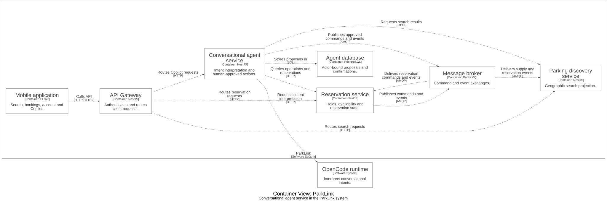

# Conversational agent service

Implements ParkLink Copilot for search and human-approved reservation actions.

## Responsibilities

- Uses an isolated OpenCode runtime for intent interpretation and deterministic services for actual data.
- Queries Discovery and Reservation, stores proposals and publishes commands only after confirmation.
- A proposed or accepted command is not proof that a reservation or payment succeeded.

## Technology

TypeScript, NestJS, PostgreSQL, RabbitMQ, OpenCode SDK.

## C4 architecture

The diagram is a C4 **container view** focused on this repository and its relevant neighbors. It is generated from [Structurizr DSL](docs/architecture/workspace.dsl) using default styles, without custom colors. Arrows show the direction of an interaction; the full model also records message flows.



To inspect or regenerate the diagram, open `docs/architecture/workspace.dsl` in Structurizr. With the Structurizr CLI and Graphviz installed:

```sh
structurizr.sh validate -workspace docs/architecture/workspace.dsl
mkdir -p /tmp/parklink-diagram
structurizr.sh export -workspace docs/architecture/workspace.dsl -format dot -output /tmp/parklink-diagram
dot -Tsvg /tmp/parklink-diagram/structurizr-Containers.dot -o docs/architecture/containers.svg
```

## Build in the integrated workspace

```sh
npm ci
npm run build:shared
npm run build -w @parklink/conversational-agent-service
```

## Repository boundary

This repository is a snapshot of `services/conversational-agent-service` from [parklink-platform](https://github.com/1ASI0728-2620-16363-ParkLink/parklink-platform). Use the integrated workspace for the root npm configuration, shared dependencies, Docker build context, tests and local infrastructure. The repositories do not automatically synchronize.
